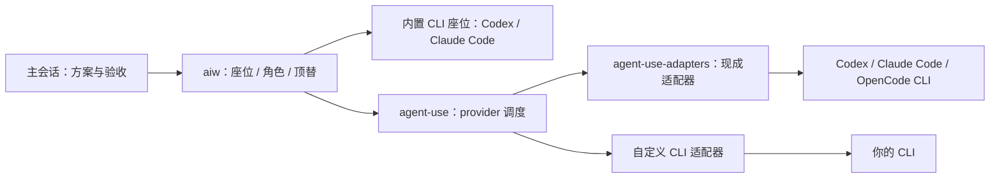

# aiw

[English](README.md) | [中文](README.zh-CN.md)

**让主会话少花 token：读代码、改文件、跑测试派出去，主会话只写单和验收。**

支持 Claude Code、Codex、pi、omp 当主会话。

下面这支 40 秒的介绍片用 [motion-use](https://github.com/leeguooooo/motion-use) 制作，片中终端里的每一行都来自一次真实派单的 aiw 输出。

https://github.com/user-attachments/assets/6cdf7ba6-5d0a-4783-9633-83842a1dc385

<p align="center"></p>

## 为什么选它

- **省主会话 token**：过程不进主会话，只收结果。作者的配对对照里主会话少花约三分之一；日常长会话中改 3 个文件以上的需求，约为自己改的四分之一。
- **你什么都不用管**：照常聊天。派不派、派给谁、怎么验收，主会话自己定；想换模型、加座位，也跟主会话说一句，它会改本地配置并用 `aiw doctor` 检查。
- **入侵少**：只在本机装了的 CLI 里加几行，改前都备份，不改 shell 配置；想先试命令可用 `--minimal` 只装命令。不想用了执行 `~/.claude/aiw/uninstall.sh`。
- **轻量**：不起服务、不常驻，派单时才运行，只要 Python 3.11+。常驻规则约 1300 字；钩子只在命中派单规则的消息上加一两行提示，其余轮次不注入。

<details>
<summary>安装具体改了哪些地方</summary>

| 主会话 | 改动 |
| --- | --- |
| Claude Code | `~/.claude/CLAUDE.md` 加一行引用，`settings.json` 加一个提示钩子，自动压缩兜底 40 万（已有设置不改） |
| Codex | `~/.codex/AGENTS.md` 加一段规则，`hooks.json` 加一个提示钩子 |
| pi / omp | `~/.pi/agent/AGENTS.md` / `~/.omp/agent/AGENTS.md` 加一段规则，不加钩子 |

另外建 `~/.local/bin/aiw` 软链，不改 shell 配置（`~/.local/bin` 不在 PATH 时只提示）。Codex、pi、omp 只在本机装了时才改。`--minimal` 只建软链，不改以上任何文件。卸载脚本可先加 `--dry-run` 预览，细节见[安装做了什么](docs/guide.zh-CN.md#安装做了什么)和[卸载](docs/guide.zh-CN.md#卸载)。

</details>

## 安装

需要 macOS（目前只在 macOS 测试过）和已登录的 Claude Code 或 Codex CLI（至少一个）。

```bash
git clone https://github.com/Jerryx333/aiw.git ~/.claude/aiw && ~/.claude/aiw/install.sh
aiw doctor   # 提示 ~/.local/bin 不在 PATH 时，按提示加上再新开终端
```

装好后照常用，不用记任何命令。

只想先试命令、不动任何配置：`~/.claude/aiw/install.sh --minimal` 只装 `aiw` 命令，不改 CLAUDE.md、settings.json、Codex 配置和 shell 配置；之后想接规则和钩子，不带参数重跑即可。安装脚本从不改 shell 配置。

<details>
<summary>想先手动试一单</summary>

```bash
printf '%s\n' '阅读本仓库，说明入口，并引用文件位置。不要修改文件。' > /tmp/aiw-review.txt
aiw review "$HOME/.claude/aiw" 900 /tmp/aiw-review.txt --ro
```

结果直接打印在终端：`[ai-worker] 实际执行方：…` 是真正干活的座位，`[ai-worker] 全文：…` 是存档位置。每单的任务原文、完整结果和错误输出都在 aiw 仓库的 `state/runs/` 里；失败时最后一行改为「排查」目录，先看其中的 `stderr.txt`。Codex 下次启动可能要求信任新钩子。

</details>

## 常见疑问

<details>
<summary>能派给哪些模型？要我自己配吗？</summary>

不用自己配。只装一家也有默认分工；想调整就跟主会话说，它改本地配置文件（`~/.config/aiw/seats.local.json`）并跑 `aiw doctor` 检查。可以做到：

- 主会话用强模型，体力活派给同一家更省的模型：比如 Codex 主会话用 GPT-6 Astra、派单用 GPT-6.1 Sol，或 Claude 主会话用 Fable、派单用 Opus 5.5（[Codex 定价](https://developers.openai.com/codex/pricing)：每百万 token，GPT-6 Astra 输入 250 / 输出 1,250 credits，GPT-6.1 Sol 输入 50 / 输出 250 credits）。同一账号下所有模型共用额度，派单不会多出额度。
- 改代码、评审、起草三类活各排一个候选顺序，第一个不可用就用下一个；任何能在终端里跑的模型都能经 agent-use 接进来。
- 改代码和评审交给不同模型，多一道交叉评审；`aiw panel` 收集多家独立意见。

配置项见[自定义](docs/guide.zh-CN.md#自定义)和[角色与单家安装](docs/guide.zh-CN.md#角色与单家安装)。

</details>

<details>
<summary>质量会不会降？</summary>

派出去的产出都是待审稿，主会话核对文件、证据和测试结果后才算数。作者做过一次对照：4 个真实需求（各改 3–7 个文件），同一份要求分别由主会话自己改、派给 Codex 改，两边都过了现有测试。请 GPT 和 Claude 盲评，GPT 在 4 题里 3 题选了 Codex 那份，Claude 3 题选了 Claude 那份、1 题打平，评委偏向自家模型，看不出哪边更好。

</details>

<details>
<summary>派单本身也花主模型 token 吧？</summary>

是的：写要求、读结果、核对都要花，所以只提示、不自动派。省多少看情况：

- 上面那 4 个需求，每个都从空会话开始做：派单时主会话合计少花约三分之一，单个需求从基本持平到少一半不等；代价是每个需求多等 10–20 分钟。
- 作者日常使用（约 300 个需求，不是对照实验）：改 3 个文件以上的需求，派单时主会话花费的中位数约为自己改的四分之一。差距可能来自长会话：平时会话常带着十几万到几十万的上下文，自己改代码的每一轮都按这个量计费。
- 改 1–2 个文件的小活没有对照数据，通常自己做更划算。

想看自己的实际用量：`aiw tokens`（本机 Claude Code 主会话用量和上下文构成）、`aiw weekly`（派单成功率、按座位 × 任务类别的质量和 token 汇总）。

</details>

<details>
<summary>常驻规则和钩子会不会把上下文搞重？</summary>

不会。常驻规则（`~/.claude/aiw/CLAUDE.md`，或 Codex 的 AGENTS 标记块）约 1300 字，细节都放在参考手册里，主会话用到时再读。钩子每轮只做一次本地正则判定（约 70 毫秒）：命中派单规则时注入一两行提示（约 100–300 字），没命中时什么都不注入；`aiw off` 关闭派单后，提示每个会话只出现一次。派出去的过程不进主会话，只收结果。

</details>

<details>
<summary>派一单要等多久？</summary>

按作者本机一周的记录（中位数）：改代码约 4 分钟（Codex 要读代码、改文件、跑测试）；只读评审、找代码约 2–3 分钟；只写文字时免费模型约 20 秒，Claude 约 2 分钟。派出去后主会话可以接着做别的；又小又急的活，自己做更快。

</details>

<details>
<summary>会不会把我的仓库改乱？</summary>

write 角色解析到 Codex 时在 Codex 沙箱里跑：只能写项目目录（在 git worktree 里还包括 `git add` 需要的 Git 目录），默认不联网。结束时列出改了哪些文件，改动留在工作区，由主会话看过再提交。只有 Claude 时用 claude-write 的受限模式和沙箱，只改工作区文件，不能 git add/commit。只读单不能改文件。

</details>

<details>
<summary>会不会花钱？代码会发到哪里？</summary>

Codex、Claude 按你自己的账号计费。接入的免费模型可以标成只用免费档，一旦检测到收费会自动停用；但这是调用之后才检测，不保证零费用。

交给哪个模型，任务要求和附带材料就发给那个模型背后的服务。只负责写文字的模型默认看不到你的代码，要你明确附上才会发过去。密码、密钥和私人数据不要交给第三方模型。

</details>

<details>
<summary>只装了一家能用吗？</summary>

能。只有 Codex：改代码主会话自己做，评审和起草派另一个 Codex 会话。只有 Claude Code：改代码派 Opus 5.5 的 `claude-write` 座位（需要 Claude Code ≥ 2.1.259；受限模式加沙箱，只能改项目目录，不能 git add/commit），评审和起草派 Opus 5.5。单家时的评审是同一家另开上下文，不是跨家族复核；会诊需要至少两家，可接 agent-use 文本座位。

</details>

<details>
<summary>Fable 会不会多花钱？</summary>

座位默认固定 Opus，不会自动用 Fable。Pro 计划上 Fable 按量付费；Max 上 Fable 计入常规周限额、最多占周限额一半，且消耗快于其他模型。见 [Claude 官方说明](https://support.claude.com/en/articles/15424964-claude-fable-models-on-your-plan)。

</details>

<details>
<summary>支持 Linux 吗？规则太强势怎么办？</summary>

Linux 尚未测试，已测试 macOS。

规则太强势：用个人规则覆盖，或从 `~/.claude/CLAUDE.md` 删除 `@~/.claude/aiw/CLAUDE.md`，或重装为 `install.sh --minimal` 只留 `aiw` 命令。若也不想收到派单提示，按[卸载小节](docs/guide.zh-CN.md#卸载)移除 aiw 钩子。

</details>

## 进阶（可以不看）

<details>
<summary>手动派单与全部命令（主会话在用，你不用记）</summary>

| 命令 | 用途与示例 |
| --- | --- |
| `aiw write . 1200 task.txt` | 改代码（Codex 主会话改文件自己做） |
| `aiw review . 900 task.txt` | 只读评审、在仓库里找代码 |
| `aiw draft . 600 task.txt` | 起草、改写、摘要 |
| `aiw doctor` | 看各角色落到哪个模型、安装是否正常 |
| `aiw <座位> . 900 task.txt` | 点名某个座位派单；常用开关 `--ro` 只读、`--worktree` 在独立 worktree 里派写单、`--net` 给 Codex 写单开放网络，细则见[参考手册](docs/reference.zh-CN.md#命令) |
| `aiw panel` | 收集多家独立意见：`aiw panel . 600 task.txt --prior prior.md`，用 `--prior` 附上自己的判断，逐条接受、驳回或暂缓，不按多数票 |
| `aiw map` | 逐文件执行同一要求：`aiw map . 600 task.txt src/a.py src/b.py` |
| `aiw goal init / verify` | 建清单 `aiw goal init docs/goals/demo.json`，修改任务、验证命令和路径后运行 `aiw goal verify docs/goals/demo.json --full` |
| `aiw off [30m/2h/3d/forever]` / `aiw on` / `aiw status` | 关闭派单提示（默认至本地次日零点）、恢复、查看状态；仍可点名派单 |
| `aiw rate` | 给派单评分：`aiw rate <run> ok\|fixed\|rework\|discard [--note 文本]`；待评分单见 `aiw rate --pending` |
| `aiw note` | 保存观察：`aiw note . "检查失败" --expected "检查通过" --evidence "测试输出"` |
| `aiw sync` | 快进更新 aiw 及已安装的 agent-use、agent-use-adapters；更新规则/钩子需重跑安装 |
| `aiw gc` | 清理旧归档（默认保留 30 天），先预览：`aiw gc 30 --dry-run` |

</details>

<details>
<summary>接更多模型：agent-use</summary>

想用其他订阅、本地或免费模型分担工作？[agent-use](https://github.com/Jerryx333/agent-use) 让终端里能用的模型都按同一种方式接进来，加几行配置即可，不用写代码；某家不可用时按你排的顺序换下一家；每次留存原文和过程记录，结果由主会话核对。

[agent-use-adapters](https://github.com/Jerryx333/agent-use-adapters) 已写好 Codex、Claude Code、OpenCode 适配器。安装时用 `~/.claude/aiw/install.sh --with-agent-use` 一起装好，并把 `opencode` 等 provider 注册进 agent-use；座位需要你自己在本地配置里加。只用内置的 Codex / Claude Code 座位时不需要这两个仓库。



接入步骤、workspace 座位和 `--text` 等细节见[使用指南](docs/guide.zh-CN.md#接入更多模型可选)。

</details>

<details>
<summary>用好它</summary>

- 先定方案，再派能写清验收条件的小块；又小又急的活自己做。
- 每单写清目标、上下文、范围、约束和验收命令；文本座位需要用 `--attach` 带上材料。
- 产出当待审稿：看改动、核对出处、跑测试，并看「实际执行方」。
- 会诊先写自己的判断，用 `--prior` 归档；大任务用 `aiw goal` 清单。

任务单模板、推荐配置和一天的用法见[最佳实践](docs/best-practices.zh-CN.md)。

</details>

<details>
<summary>状态栏和看板：aiw-board</summary>

[aiw-board](https://github.com/Jerryx333/aiw-board) 是独立的只读状态栏和看板，不派单、不写 aiw 状态；展示在途派单、实际执行方、会诊分组、刚完成的成败和今日单数。

```bash
git clone https://github.com/Jerryx333/aiw-board.git
cd aiw-board
./install.sh --apply-settings
```

安装会备份并替换已有 ccstatusline 配置；`--apply-settings` 会修改 Claude Code settings（先备份），不想自动修改就去掉该参数。装好后用 `aiw board` 打开完整看板。

</details>

## 文档与贡献

[使用指南](docs/guide.zh-CN.md)（安装细节、工作原理、定制） · [最佳实践](docs/best-practices.zh-CN.md) · [参考手册](docs/reference.zh-CN.md)（全部命令与细则） · [贡献指南](CONTRIBUTING.zh-CN.md)

改动走 PR，提交前运行 `python3 tests/test_harness.py` 和 `python3 tests/mutation_check.py`。许可证：[Apache-2.0](LICENSE)。
